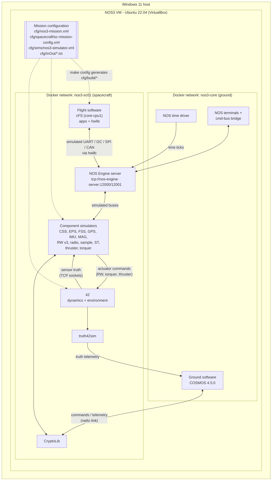
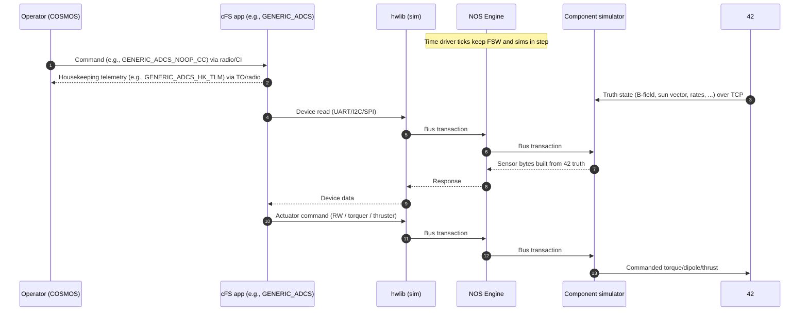

# NOS3 Baseline Architecture (Initial Digital-Twin Diagram)

Baseline: `SBP-NOS3-BL-01` (NOS3 commit `5a3bdee6be9a2c67fdf994ae6db56d5c60395302`)

This document describes how the stock NOS3 reference mission fits together. It shows the relationships among NOS3, NOS Engine, 42, flight software, component simulators, ground software, and mission configuration (Sprint 2). Detailed source tracing of individual components is in the [Sprint 3 Architecture Note](../sprint3/architecture-note.md).

All file paths are relative to the root of the NOS3 checkout (`~/Desktop/github-nos3` in the VM).

## 1. NOS3 and the overall test environment

NOS3 is not a single program. It is a set of cooperating processes that `make launch` starts, each in its own Docker container inside the Ubuntu VM. The launch script for the cFS configuration is `scripts/fsw/fsw_cfs_launch.sh`. It creates two Docker networks:

- `nos3-core` is the ground side. It holds COSMOS, the NOS terminals, the command-bus bridge, and the time driver.
- `nos3-sc01` is the spacecraft side. It holds the flight software, the NOS Engine server, 42, the component simulators, and CryptoLib. COSMOS and the time driver also connect to it.

Note: the radio path and CryptoLib routing are simplified here. Trace them in Sprint 3 before relying on this diagram for the exact radio data path.

## 2. Flight software

- Framework: NASA core Flight System (cFS). Selected by `<fsw>cfs</fsw>` in `cfg/nos3-mission.xml`. NOS3 also supports F′ (`fsw/fprime/`), which matters for Sentinel-Bio+ but is not part of this baseline.
- Core and OS layers: `fsw/cfe`, `fsw/osal`, `fsw/psp`. The OSAL and PSP are built as `nos-linux` variants so that cFS time comes from NOS Engine (see `osal_nos-linux_impl` and `psp-nos-linux-impl` in `evidence/logs/build.log`).
- Heritage applications: `fsw/apps/` (CI, TO, SCH, SC, LC, DS, FM, CF, and others).
- Component applications: each `components/<name>/fsw/cfs/`. They are listed in `cfg/nos3_defs/targets.cmake` and started by `cfg/nos3_defs/cpu1_cfe_es_startup.scr`.
- Hardware access: every component app talks to its device through hwlib (`fsw/apps/hwlib`). In this baseline, hwlib is built with its `sim` back end (`apps/hwlib/sim`, library `noslink`), which routes bus calls to NOS Engine instead of real Linux device drivers.
- Runs in the container `sc01-nos-fsw` (terminal "sc01 - NOS3 Flight Software") through `scripts/fsw/fsw_respawn.sh`.

## 3. NOS Engine

- Middleware that provides simulated hardware buses and shared simulation time between flight software and simulators.
- Server: `/usr/bin/nos_engine_server_standalone` in the container `sc01-nos-engine-server`, configured by `cfg/sims/nos_engine_server_config.json`. That file defines two server URIs, `fsw` at `tcp://nos-engine-server:12000` and `nos3` at `tcp://nos-engine-server:12001`, and loads the `uart` plugin.
- Each simulator declares its bus connections in `cfg/sims/nos3-simulator.xml`. For example, `generic-mag-sim` uses `spi_2` with chip select 2, the reaction wheels use `usart_2`–`usart_4`, and `generic-eps-sim` uses `i2c_1` at address `0x2B`.
- Time: `nos_time_driver` (`sims/nos_time_driver`) publishes ticks on the `command` bus. The baseline uses 10,000 µs per tick at 1.0× speed, as shown in the "NOS Time Driver" terminal.

## 4. Component simulators

- Source: each `components/<name>/sim/`. Common framework: `sims/sim_common`.
- All simulators are built into `sims/build/bin` and launched as `./nos3-single-simulator -f nos3-simulator.xml <sim-name>`.
- Each simulator has a hardware model (bus protocol and device behavior) and a data provider. The data provider is either a 42 socket provider (for example, `GENERIC_MAG_42_PROVIDER` on port 4234) or a shared-memory or file provider.
- Enabled in this baseline (`sc-mission-config.xml`): ADCS (FSW app only), CSS, EPS, FSS, GPS (NovAtel OEM615), IMU, MAG, MGR, radio, reaction wheels (3), sample, star tracker, torquer, and thruster. Disabled: camera (arducam), OnAIR, SYN, and SBN.

## 5. 42

- NASA's spacecraft dynamics and environment simulator. It runs in the container `sc01-fortytwo` with hostname `fortytwo`.
- Inputs: `cfg/InOut/` (copied to `~/.nos3/42/NOS3InOut` at launch). Scenario files include `Inp_Sim_STF1.txt`, `SC_NOS3.txt`, `Orb_LEO.txt`, and `Inp_IPC.txt`.
- Outputs: the 42 Map, Cam, and Unit Sphere windows, plus TCP socket streams to each simulator's 42 data provider. It also receives actuator commands back (wheel torque, magnetorquer dipole, thruster) on the command ports listed in `nos3-simulator.xml`.
- `truth42sim` (`sims/truth_42_sim`) forwards 42 truth data to COSMOS on port 5111. It appears as the `SIM_42_TRUTH_INT` interface in COSMOS.

## 6. Ground software

- COSMOS 4.5.0 (classic COSMOS, Docker image `ballaerospace/cosmos:4.5.0`). Selected by `<gsw>cosmos</gsw>`. Container name: `cosmos-openc3-operator-1`.
- Launch script: `scripts/gsw/gsw_cosmos_launch.sh`. Configuration: `gsw/cosmos/`.
- Interfaces seen in the Command and Telemetry Server: `DEBUG`, `RADIO`, `CFDP_INT`, `SIM_42_TRUTH_INT`, and `SIM_CMDBUS_BRIDGE` (see [command-check.png](../../evidence/screenshots/command-check.png)).
- Command and telemetry definitions for each component: `components/<name>/gsw/` (for example, `generic_mag.xtce`).

## 7. Mission configuration

| File | Controls |
|---|---|
| `cfg/nos3-mission.xml` | FSW (cfs/fprime), GSW, scenario, start time, number of spacecraft, which spacecraft config to use |
| `cfg/spacecraft/sc-*-config.xml` | Which apps and components are enabled, GUI on/off, orbit tip-off rates, truth interface |
| `cfg/sims/nos3-simulator.xml` | Simulator list, bus connections, 42 data-provider ports |
| `cfg/sims/nos_engine_server_config.json` | NOS Engine server URIs and plugins |
| `cfg/InOut/*.txt` | 42 scenario: orbit, spacecraft model, graphics, IPC sockets |
| `cfg/nos3_defs/targets.cmake`, `cpu1_cfe_es_startup.scr` | Which cFS apps are built and started |

`make config` runs `scripts/cfg/config.sh` and `scripts/cfg/configure.py`. Those read the files above and write the active copies to `cfg/build/`. For example, disabled components have their lines removed (`[REMOVE] arducam disabled` in `build.log`). Edit the files in `cfg/`, never the copies in `cfg/build/`.

## 8. Command, telemetry, and simulation-data flow

## 9. Summary table

| Architecture item | Item in baseline | Evidence | Uncertainty |
| --- | --- | --- | --- |
| Ground software | COSMOS 4.5.0 (classic), Docker image `ballaerospace/cosmos:4.5.0` | COSMOS image pull in [build.log](../../evidence/logs/build.log); `<gsw>cosmos</gsw>` in `cfg/nos3-mission.xml` | None. The container name includes "openc3", but the image is classic COSMOS 4.5.0 |
| Flight-software framework | cFS (cFE + OSAL/PSP `nos-linux` builds) | `fsw : cfs` in build.log `make config` output; cFE CMake output | None |
| Commanded application | `GENERIC_ADCS` (NOOP), from `components/generic_adcs` | [command-check.png](../../evidence/screenshots/command-check.png) | None |
| Component simulators | CSS, EPS, FSS, GPS, IMU, MAG, RW ×3, radio, sample, star tracker, thruster, torquer | `cfg/spacecraft/sc-mission-config.xml`; launch lines in `scripts/fsw/fsw_cfs_launch.sh` | `camsim` is launched by the script even though the camera is disabled in config. Confirm whether it runs |
| Hardware abstraction / NOS Engine | hwlib `sim` back end (`noslink`) maps FSW bus calls to NOS Engine. NOS Engine provides simulated buses and simulation time | `apps/hwlib/sim/... noslink` in build.log; `cfg/sims/nos_engine_server_config.json` | Detailed mechanism traced in Sprint 3 |
| Dynamics/environment | 42, scenario `STF1` | `scenario: STF1` in build.log; 42 windows in screenshots | None |
| Execution environment | Ubuntu 22.04.4 VM in VirtualBox 7.2. Each NOS3 process runs in Docker (`ivvitc/nos3-64:20260619`) | `DBOX` in `scripts/env.sh`; window titles "(on fortytwo)" and "(on 2de237ac7dbd)" are container hostnames | Record the Docker version and image digest from inside the VM |

### Scope and verification status

This document describes the stock NOS3 baseline used for architecture study. It does not claim that Sentinel-Bio+ mission software or custom component models have been integrated.
