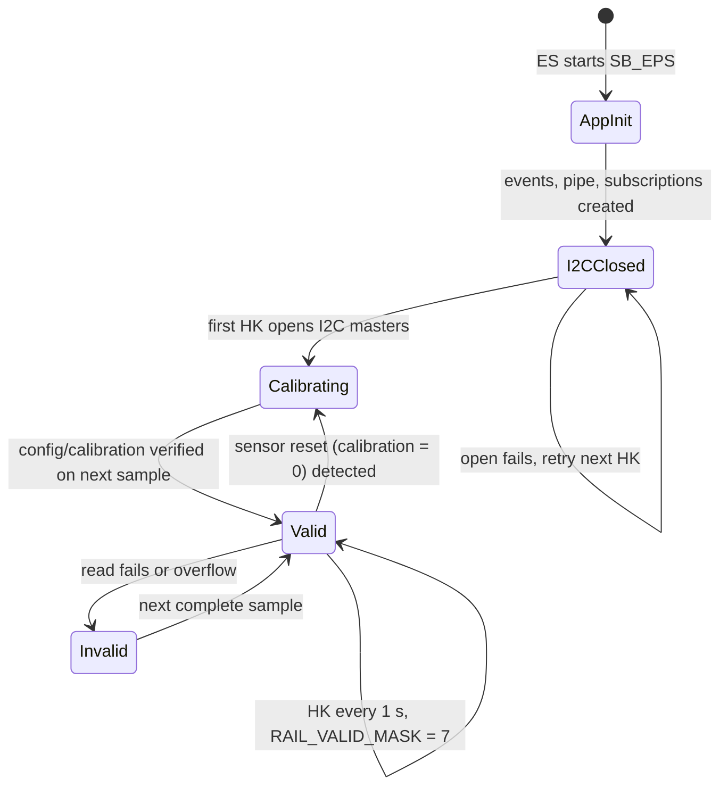

# EPS Command and Telemetry Interface Definition

Document ID: `SBP-IF-EPS-01`, revision A (draft), November 20, 2026.
Applies to: `sentinelbio_flatsat_eps` component version `2.0.0`, baseline `SBP-NOS3-BL-02` (candidate).

Sprint 4 deliverables (execution plan §7.4): "Updated OBC/EPS and external-interface definitions" and "Common telemetry/interface definition for the modeled/emulated function." Any FlatSat or Arduino EPS representation must use this same logical contract so results can be compared without changing the mission-level definition.

Source of truth for every value below: `nos3/components/sentinelbio_flatsat_eps/` (`fsw/cfs/platform_inc/`, `fsw/cfs/src/sentinelbio_flatsat_eps_msg.h`, `gsw/SENTINELBIO_FLATSAT_EPS/cmd_tlm/`, `docs/PROTOCOL.md`).

## 1. Message IDs

| Message | MID | Direction |
|---|---|---|
| EPS command | `0x19E0` | Ground → `SB_EPS` |
| HK request | `0x19E1` | SCH or ground → `SB_EPS` |
| HK telemetry | `0x09E0` | `SB_EPS` → TO → ground |

These MIDs must stay unique in the mission.

## 2. Commands

All commands use the 8-byte cFS command header (CCSDS primary header plus function code and checksum).

| COSMOS name | MID | CC | Payload | Accepted behavior | Counter effect |
|---|---|---|---|---|---|
| `SENTINELBIO_FLATSAT_EPS_NOOP_CC` | `0x19E0` | 0 | none | Event `SENTINELBIO_FLATSAT_EPS: NOOP command received`; no state change | `CMD_COUNT` +1 |
| `SENTINELBIO_FLATSAT_EPS_RESET_COUNTERS_CC` | `0x19E0` | 1 | none | Event `RESET counters command received` | All four counters set to 0 |
| `SENTINELBIO_FLATSAT_EPS_SWITCH_CC` | `0x19E0` | 2 | `SWITCH_NUMBER` u8 (0–7), `STATE` u8 (`0x00` OFF / `0xAA` ON) | Unsupported compatibility command. No rail changes | `CMD_ERR_COUNT` +1 |
| `SENTINELBIO_FLATSAT_EPS_REQ_HK` | `0x19E1` | 0 | none | Reads all three rails and publishes one HK packet | `DEVICE_COUNT` or `DEVICE_ERR_COUNT` +1 |

Acknowledgment: there is no separate acknowledgment packet. Command acceptance is confirmed by the FSW event message and by `CMD_COUNT` / `CMD_ERR_COUNT` in the next HK packet. A Command Sender log only proves the command was sent.

Error behavior: an unknown function code, unexpected MID, or wrong command length increments `CMD_ERR_COUNT` and produces an error event (for example, `SB_EPS: bad command length actual=... expected=...`). A `REQ_HK` with a nonzero function code increments `CMD_ERR_COUNT` and publishes nothing.

## 3. Housekeeping telemetry

Packet: `SENTINELBIO_FLATSAT_EPS_HK_TLM`, MID `0x09E0`, 64 bytes total, payload little-endian (CCSDS header fields big-endian).

Rate: one packet every **1 second** (observed). The scheduler sends `REQ_HK`; the app also publishes after a 1000 ms idle receive timeout (`SENTINELBIO_FLATSAT_EPS_CFG_IDLE_HK_MS`). A ground `REQ_HK` produces an additional packet on demand.

| Byte offset | Field | Type | Units / meaning |
|---|---|---|---|
| 0–15 | CCSDS primary + secondary header + spare | — | Time stamp: `CCSDS_SECONDS`, `CCSDS_SUBSECS` |
| 16 | `CMD_ERR_COUNT` | u8 | Rejected commands (wraps at 255) |
| 17 | `CMD_COUNT` | u8 | Accepted commands (wraps at 255) |
| 18 | `DEVICE_ERR_COUNT` | u8 | HK cycles with one or more invalid rails |
| 19 | `DEVICE_COUNT` | u8 | HK cycles with all three rails valid |
| 20 | `RAIL_12V_BUS_MV` | u16 | mV |
| 22 | `RAIL_12V_SHUNT_UV` | i32 | µV |
| 26 | `RAIL_12V_CURRENT_MA` | i16 | mA |
| 28 | `RAIL_12V_POWER_MW` | u16 | mW |
| 30 | `RAIL_12V_CONFIGURATION` | u16 | INA219 config register (expect `0x399F`) |
| 32 | `RAIL_12V_CALIBRATION` | u16 | INA219 calibration register (expect `4096`) |
| 34–47 | `RAIL_5V_*` | same layout as 12 V | |
| 48–61 | `RAIL_3V3_*` | same layout as 12 V | |
| 62 | `RAIL_VALID_MASK` | u8 | bit0 = 12 V, bit1 = 5 V, bit2 = 3.3 V; `7` = all valid |
| 63 | `I2C_READY_MASK` | u8 | I2C master handles opened (not sensor presence) |

Version identification: the component version (`2.0.0`) is reported at startup in the syslog (`SB_EPS: EPS_AppMain entered; package 2.0.0`) and in the initialization event (`... App Initialized. Version 2.0.0`). The HK packet itself carries the cFS time stamp but no version field.

## 4. Device interface (FSW ↔ simulator)

Each rail is one INA219 on its own NOS Engine I2C bus. The register map, encoding, and conversion equations are in `nos3/components/sentinelbio_flatsat_eps/docs/PROTOCOL.md`.

| Rail | Bus | 7-bit address | Nominal voltage | Default current |
|---|---|---|---|---|
| 12 V | `i2c_1` | `0x40` | 12.0 V | 0.25 A |
| 5 V | `i2c_2` | `0x41` | 5.0 V | 0.50 A |
| 3.3 V | `i2c_3` | `0x44` | 3.3 V | 0.75 A |

Engineering-unit conversion in FSW: `bus_mV = (reg >> 3) × 4`, `shunt_uV = signed(reg) × 10`, `current_mA = signed(reg) × 0.1`, `power_mW = reg × 2`.

## 5. Interface states

| State | `I2C_READY_MASK` | `RAIL_VALID_MASK` | Counter that advances |
|---|---|---|---|
| I2C closed | 0 | 0 | `DEVICE_ERR_COUNT` |
| Calibrating (first cycle after open or sensor reset) | 7 | 0 or partial | `DEVICE_ERR_COUNT` (normal, once) |
| Valid | 7 | 7 | `DEVICE_COUNT` |
| Invalid rail | 7 | bit cleared for that rail; its fields are zeroed | `DEVICE_ERR_COUNT` |

## 6. Load pulses (simulator-side)

The hardware simulator can apply pulses of more or less load to any rail. During a pulse, the rail's current (and therefore shunt voltage and power) changes in HK. The rail voltage stays at its defined value. This has been observed in HK as a current increase on the pulsed rail. Pulses are a simulation input only; they do not appear as an FSW command and are not part of the flight command set.

Open item EPS-OI-01: record the pulse command syntax and commit the pulse-capable simulator source. See [the EPS component note](../sprint4/eps-component.md#5-known-limitations-and-open-items).

## 7. Mapping to other representations

| Representation | Status |
|---|---|
| NOS3 / software | Implemented (`SBP-NOS3-BL-02`) |
| Development FlatSat | Not yet compared. FlatSat INA219 addresses and rails must be confirmed against §4 |
| Arduino emulator | Not used. If built, it must answer the same INA219 registers at the same addresses |
| Flight EPS (EnduroSat) | Not represented. The flight EPS uses its own telemetry protocol; this contract will need an adapter or revision |
