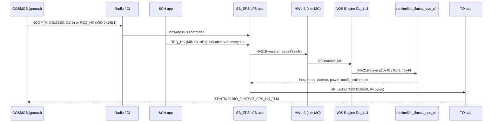

# Sentinel-Bio+ FlatSat EPS Component (First NOS3 Extension)

Sprint 4 (October 26 – November 8, 2026) deliverable: "First Sentinel Bio+ NOS3 component/service source code and configuration" (execution plan §7.4). Status updated November 20, 2026.

Representation exercised: **NOS3 / software only**. This is development evidence. It is not FlatSat or flight-hardware evidence.

## 1. Summary

The custom `sentinelbio_flatsat_eps` component is the **configured EPS** in the Sentinel-Bio+ NOS3 mission. It replaces the stock `generic_eps` simulator in the active simulator configuration and runs as the `SB_EPS` cFS app.

| Item | Value |
|---|---|
| Component version | `2.0.0` (`SENTINELBIO_FLATSAT_EPS_MAJOR/MINOR/REVISION = 2/0/0`, mission rev 0) |
| Source location | [`nos3/components/sentinelbio_flatsat_eps/`](../../nos3/components/sentinelbio_flatsat_eps/) |
| cFS library / entry point / app name | `sentinelbio_eps.so` / `EPS_AppMain` / `SB_EPS` |
| Simulator name / library | `sentinelbio_flatsat_eps_sim` / `libsentinelbio_flatsat_eps_sim.so` |
| Sensor model | Three TI INA219 current/power monitors, one per regulated rail |
| Ground target | `SENTINELBIO_FLATSAT_EPS` (COSMOS), plus XTCE for YAMCS |
| Integrated on | NOS3 commit `5a3bdee6be9a2c67fdf994ae6db56d5c60395302`, cFS, single spacecraft |
| Installed | November 18, 2026 (installer backup `nos3/sentinelbio_eps_backups/20261118_022933_481044/`) |
| Baseline | `SBP-NOS3-BL-02` (candidate). See [configuration control](../baseline/config-control.md) |

## 2. What the model does

The model represents a regulated power distribution with three fixed rails. The rail voltages are defined in the simulator configuration and do not change during a run. Rail current is also stationary (constant) unless a load pulse is applied (see §4).

| Rail | Defined voltage | Default steady load | Default power | NOS Engine bus | INA219 address | cFS HWLIB handle |
|---|---|---|---|---|---|---|
| 12 V | 12000 mV | 250 mA | 3000 mW | `i2c_1` | `0x40` | 1 |
| 5 V | 5000 mV | 500 mA | 2500 mW | `i2c_2` | `0x41` | 2 |
| 3.3 V | 3300 mV | 750 mA | 2474 mW (register quantization) | `i2c_3` | `0x44` | 3 |

Model assumptions (from `nos3/components/sentinelbio_flatsat_eps/sim/cfg/nos3-eps-simulator.xml`):

- 14.0 V bench-supply input (allowed 12.0–16.0 V). This is not a battery model.
- 0.1 Ω shunt per rail; INA219 configuration `0x399F`; FSW programs calibration `4096` (simulator starts at `0`, as after sensor power-on reset).
- Regulator: reports the defined nominal voltage when the input is at least nominal + dropout (dropout = 0 V by default).
- Not modeled: battery, solar array, charger, switchable rails, regulator dynamics, ADC conversion timing.

These values are simulation assumptions. They are not measured FlatSat values or EnduroSat flight EPS specifications.

## 3. Data path

Integration points changed by the installer (all inside `nos3/`, listed for traceability only):

| File | Change |
|---|---|
| `cfg/nos3_defs/targets.cmake` | Adds `sentinelbio_flatsat_eps/fsw/cfs` to the cFS build |
| `cfg/nos3_defs/cpu1_cfe_es_startup.scr` | `CFE_APP, sentinelbio_eps, EPS_AppMain, SB_EPS, 63, 32768, 0x0, 0;` |
| `cfg/nos3_defs/tables/sch_def_msgtbl.c` | Scheduler message table entry for `SENTINELBIO_FLATSAT_EPS_REQ_HK_MID` |
| `cfg/nos3_defs/tables/to_lab_sub.c`, `to_config.c` | TO forwards `0x09E0` to the ground |
| `cfg/nos3_defs/tables/lc_def_wdt.c`, `sc_rts027.c`, `sc_rts029.c`–`sc_rts037.c` | Stock LC battery watchpoints 27/28 disabled (new packet has no battery field); RTS references updated |
| `cfg/sims/nos3-simulator.xml` (and sc-1/2/3, sockets, shmem, multipleGDS variants) | `sentinelbio_flatsat_eps_sim` replaces the generic EPS simulator |
| `scripts/fsw/fsw_cfs_launch.sh` (and F′, multi-SC, multi-GSW, `launch_sat.sh`, `ci_launch.sh` variants) | "EPS Sim" tab launches `sentinelbio_flatsat_eps_sim` |
| `scripts/cfg/configure.py`, `configure_cosmos_target.py`, `declare_cosmos_target.py`, `configure_test_runner.py`, COSMOS `system.txt` / `cmd_tlm_server.txt` / `test_runner.txt`, YAMCS `*.nos3.yaml` | Ground target and packet definitions |
| `cfg/spacecraft/sc-mission-config.xml` | `components/eps/enable = true` |

## 4. Demonstrated behavior

Recorded in [TR-20261120-01](../../evidence/test-records/2026-11-20-sentinelbio-eps-checkout.md).

| Capability | Result |
|---|---|
| EPS is the configured EPS | `SB_EPS` app and `sentinelbio_flatsat_eps_sim` load in place of the generic EPS |
| Periodic HK | EPS publishes `SENTINELBIO_FLATSAT_EPS_HK_TLM` every 1 second |
| `SENTINELBIO_FLATSAT_EPS_REQ_HK` | Commanded HK request from the ground works and returns an HK packet |
| `SENTINELBIO_FLATSAT_EPS_NOOP_CC` | EPS app receives NOOP commands |
| Fixed rail voltages | 12 V, 5 V, and 3.3 V rails report their defined voltages |
| Stationary current | Rail currents hold at the configured steady load when no pulse is applied |
| Load pulses | The hardware simulator can apply "pulses" of more or less load on any rail. A pulse was observed in the HK packets as an increase in the pulsed rail's current |

## 5. Known limitations and open items

| ID | Item | Action |
|---|---|---|
| EPS-OI-01 | The load-pulse feature is used in the working VM, but the committed simulator source (`sim/src/sentinelbio_flatsat_eps_hardware_model.cpp`) and the component README still describe a steady-state model with no pulse command. | Commit the pulse-capable simulator source and document the pulse command syntax (rail, magnitude, duration) |
| EPS-OI-02 | HK, NOOP, and pulse results do not yet have attached screenshots or logs. | Add COSMOS Packet Viewer screenshots and FSW/simulator logs to `evidence/` |
| EPS-OI-03 | No comparison yet against FlatSat EPS hardware or an Arduino emulator (§7.4 "compare the NOS3 model outputs with the emulator/FlatSat behavior for at least one controlled case"). | Run one controlled case on the FlatSat INA219 path or an Arduino emulator using the same packet definition |
| EPS-OI-04 | Rail values are assumptions, not measured FlatSat or EnduroSat EPS data. | Replace with measured FlatSat values and selected flight EPS rail limits |
| EPS-OI-05 | No automated/scripted end-to-end test with raw results in the VM (component unit tests exist under `nos3/components/sentinelbio_flatsat_eps/tests/`). | Add a scripted HK/NOOP/pulse check and store its raw output |
| EPS-OI-06 | `SENTINELBIO_FLATSAT_EPS_SWITCH_CC` exists only for packet compatibility and is rejected (no switchable rails). | Define switch behavior if rail switching is needed for Sprint 6 fault cases |
| EPS-OI-07 | Build/run instructions for this new NOS3 configuration are not written yet. | Write the BL-02 build/run guide |

## 6. Related documents

- [EPS interface definition](../interfaces/eps-interface-definition.md) (command and telemetry contract)
- Component documentation inside the code tree: `nos3/components/sentinelbio_flatsat_eps/README.md`, `INSTALL.md`, `docs/PROTOCOL.md`, `docs/VALIDATION.md`
- [Sprint 3 architecture note](../sprint3/architecture-note.md)
